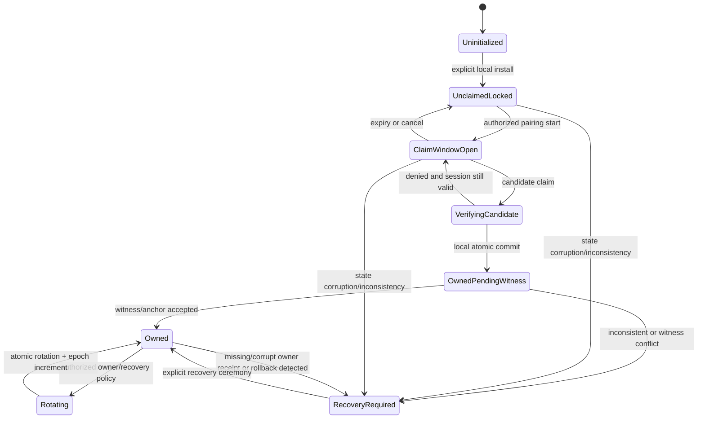

# Sprout: sikker vurdering av nyfødtmodus og første eierbinding

Dato: 2026-07-18  
Status: anbefalt designgrunnlag; menneskelig beslutning og implementasjon gjenstår  
Beslutningseier: Kjetil / HAVEN Identity + Security

## Kort konklusjon

Sprout bør ha en avgrenset førstegangsmodus, men den bør hete `unclaimed`
eller `ownerBindingRequired` i protokoll og kode. Den må **ikke** gjøre den
første innkommende Identity til eier automatisk.

Den sikre modellen er:

1. En eksplisitt lokal installasjon oppretter en installasjonsnøkkel og en
   persistent, låst `unclaimed`-tilstand.
2. En operatør eller autorisert utrullingsprosess åpner et kortvarig
   eierbindingsvindu.
3. En innkommende Identity blir bare en *eierkandidat*.
4. Kandidaten må signere en engangsutfordring som binder sammen
   installasjons-ID, installasjonsnøkkel, scaffold-domene, kandidatens
   Identity, ønsket handling, tidspunkt og relevant autorisasjonsbevis.
5. Sprout verifiserer signatur, domene, challenge, utløp, replay-status og den
   valgte bootstrap-autoriteten. For et eksisterende organisasjons-scaffold
   betyr dette normalt et signert grant/Contract og Entity-bevis. For et helt
   nytt personlig scaffold kan eksplisitt lokal brukerbekreftelse være selve
   genesis-autoriteten.
6. En transaksjon lagrer bindingen én gang, lukker challenge og øker en
   monoton eier-epoke. Etter dette finnes ingen overgang tilbake til
   `unclaimed`.
7. Manglende eller korrupt eierstatus etter at installasjonen har vært eid gir
   `recoveryRequired`, aldri ny førstegangsmodus.

Dette gir den gode brukeropplevelsen i en «nyfødtmodus» uten å gjøre nettverks-
rekkefølge til et autorisasjonsbevis.

## Formål og mål

### Formål 1

- `purposeRef`: `purpose://access.audit.privacy`
- Intensjon: bare en eksplisitt autorisert, domenebundet Identity skal kunne
  etablere eller endre Sprouts eierforhold.
- Goal-ID i denne vurderingen: `goal.sprout.owner-bootstrap-security-assessment`
- Metrikk: en dokumentert autorisasjonssti og en testbar avvisningsmatrise for
  førstegangsclaim, omstart, replay, korrupsjon, rollback og recovery.
- Baseline: Sprout kan generere en lokal «owner»-nøkkel, men har ingen
  implementert ekstern eierbinding eller persistent lifecycle-policy.
- Mål: anbefalt modell, trusselmodell og akseptansekriterier dokumentert.
- Tid: denne vurderingen, 2026-07-18.
- Evidens: lokal kode og dokumentasjon listet under, CellProtocol-kontraktene
  for Identity/Agreement/Resolver og eksterne primærkilder.
- Status: `satisfied` for designvurderingen; produksjonskontroller er ikke
  implementert.

### Formål 2

- `purposeRef`: `purpose://human-agency`
- Intensjon: førstegangsoppsett skal være forståelig og eksplisitt, og personen
  skal kunne se hvilken installasjon og Identity som bindes før godkjenning.
- Goal-ID i denne vurderingen: `goal.sprout.owner-bootstrap-usable-ceremony`
- Metrikk: én anbefalt seremoni for personlig, on-prem og cloud/managed drift,
  med synlig fingerprint/kode og eksplisitt godkjenn/avvis.
- Baseline: dokumentet `signed_sprout_executable_first_run.md` skisserer en
  challenge, men flyten er ikke implementert.
- Mål: operasjonell sekvens og deployment-profiler er spesifisert.
- Tid: denne vurderingen, 2026-07-18.
- Evidens: repoets first-run-design og RFC 8628s brukerbekreftede device flow.
- Status: `satisfied` for designvurderingen.

### Formål 3

- `purposeRef`: `purpose://test.acceptance`
- Intensjon: sikkerhetskontrakten skal kunne bevises med positive, negative,
  samtidighets- og crash/restart-tester.
- Goal-ID i denne vurderingen: `goal.sprout.owner-bootstrap-acceptance-plan`
- Metrikk: testmatrise som dekker alle autorisasjons- og persistensgrenser.
- Baseline: eierlager-testene dekker oppretting, gjenbruk og ugyldig domene,
  men ikke claim, recovery, restart, korrupsjon eller rollback.
- Mål: prioritert testplan med eksplisitte invariants.
- Tid: denne vurderingen, 2026-07-18.
- Evidens: eksisterende tester og testplanen nedenfor.
- Status: `satisfied` for designvurderingen.

## Hva er ressursen og autorisasjonsgrensen?

Beskyttet ressurs er Sprout-installasjonens eksklusive eierforhold og alle
handlinger som følger av det, særlig muligheten til å:

- utstede eller endre scaffoldets admin trust root;
- delegere administrative handlinger;
- godkjenne medlemskap, opptak og resolver-policy;
- signere programvarekatalog eller andre scaffold-autoritative artefakter;
- rotere eller gjenopprette eier.

Forespurt handling ved førstegangsoppsett er `claim installation ownership`.
Dette er en egen, engangs autorisasjonshandling. Den må ikke implisitt følge av
at en Identity kan nå en transport, kan signere med sin egen nøkkel, bærer en
tekstetikett som «admin», eller var raskest på nettverket.

CellProtocol-grensen er avgjørende:

- En Identity-signatur beviser kontroll over Identity-nøkkelen, ikke rett til
  å eie installasjonen.
- En vault domain binding er kontekstevidens og har uttrykkelig
  `grantsAuthority = false`.
- En Agreement uttrykker et ønske, ikke en grant.
- Autoritet må komme fra verifisert owner-proof, Contract/Grant, en eksplisitt
  og smal cell-policy eller genesis-autoriteten i en lokalt bekreftet ny
  installasjon.
- Resolveren er policygrensen. Transport, Bonjour, QR, URL og ankomstrekkefølge
  er aldri autoritet.

## Viktig rolleskille

Dagens navn blander tre forskjellige roller. De bør splittes før eierbinding
implementeres:

1. **Installation Identity**: maskin-/prosessnøkkelen Sprout oppretter lokalt.
   Den signerer challenges, receipts og maskinens forespørsler. Den er ikke
   automatisk menneskelig eier.
2. **Owner Identity**: den domenebundne Identity som har øverste
   eierautoritet. Privatnøkkelen skal forbli i eierens vault/Binding og trenger
   ikke eksporteres til Sprout.
3. **Scaffold admin/service Identity**: en lokal, automatiserbar Identity som
   kan få et avgrenset og tilbakekallbart admin-grant fra eier. Den er delegat,
   ikke nødvendigvis eier.

Dette betyr at dagens `ScaffoldOwnerIdentityStore` semantisk nærmere er et
`ScaffoldInstallationIdentityStore` eller `ScaffoldAdminSigningIdentityStore`.
Å generere en lokal nøkkel gjør ikke i seg selv en ekstern persons Identity til
eier.

## Dagens repo: hva finnes og hva mangler?

### Implementert og nyttig

- `ScaffoldOwnerIdentityStore` lager en domeneskopet Ed25519-nøkkel, lagrer
  record og seed separat og setter restriktive POSIX-rettigheter.
- Gjentatt `initialize` returnerer eksisterende record når den kan lastes.
- `owner trust-root` signerer en eksplisitt
  `ScaffoldAdminTrustRootDescriptor`.
- Hoved-bootstrapen verifiserer Identity-domene, eksplisitt Purpose/Goal,
  signert starter payload, admin trust root, resolveravgjørelse,
  EntityInclusionProof og PortholeAccessContract.
- First-run-dokumentet foreslår allerede engangs challenge,
  `SproutOwnerBindingClaim`, Entity-evidens og lokal receipt.

### Sikkerhetsgap som må lukkes

1. **Ingen ekstern eierbinding er implementert.** `owner init` oppretter en
   lokal nøkkel, ikke et bevis på hvem som eier installasjonen.
2. **Korrupt record kan bli tolket som fravær.** `initialize` bruker
   `try? load(...)`; alle load-feil faller derfor videre til ny nøkkelgenerering
   når `overwrite` er av. Parsefeil, I/O-feil eller feil record må gi
   `recoveryRequired`, ikke ny identitet.
3. **`--overwrite` kan erstatte eiernøkkelen direkte.** Det er en
   reset/rotation-bypass og må fjernes fra normal `owner init`.
4. **Record og seed verifiseres ikke som ett invariant.** `load` sjekker ikke
   at seed finnes, har 32 byte, har sikre rettigheter og faktisk avleder
   `identity_public_key` i recorden.
5. **Ingen persistent lifecycle-marker.** «Har denne installasjonen noen gang
   vært eid?» er ikke en egen, signert tilstand med epoke.
6. **Ingen atomisk one-winner-claim.** Actor-isolasjon beskytter bare én
   prosess; den gir ikke compare-and-swap mellom prosesser eller på tvers av
   crash.
7. **Prototypeplanner overvurderer discovery.** Bonjour eller signert QR gir en
   ikke-blokkerende plan, men discovery/signatur alene sier ikke at Identity har
   eierautoritet.
8. **Trust-root-signering er ikke gated på ekstern owner binding.** En lokal
   generert nøkkel kan i dag signere trust root umiddelbart.
9. **Lokal filseed er ikke en produksjonsvault.** POSIX `0600` er nyttig, men
   gir ikke hardware-beskyttelse, brukerbekreftelse eller anti-rollback.
10. **Auditloggen er ikke en anti-tamper-ledger.** Den er append-only ved normal
    bruk, men er verken hash-kjedet, signert, fsync-dokumentert eller eksternt
    forankret.
11. **Ingen recovery-kontrakt.** Restart, owner rotation, recovery og factory
    reset har ikke separate policygrenser.

Konsekvensen er at vanlig prosessomstart ikke i seg selv nullstiller dagens
record, men dagens lagring er ikke sterk nok til å bevise at installasjonen
aldri har vært eid når filer er manglende, korrupte, erstattet eller rullet
tilbake.

## Påstandslogg og adjudikering

### C-001: «Første innkommende Identity kan trygt bli eier»

- Type/styrke: normativ, assertiv.
- Vurdering: `contradicted` for alle nettverkseksponerte og automatiske
  varianter.
- Begrunnelse: ankomstrekkefølge beviser bare timing. En angriper på samme LAN,
  en fjern scanner, en kompromittert proxy eller en prosess som vinner et race
  kan bli permanent eier. Identity-signatur beviser bare nøkkelkontroll.
- Dom: skal ikke implementeres.

### C-002: «En nyfødtmodus kan gi en god og forståelig førsteopplevelse»

- Type/styrke: normativ, moderert.
- Vurdering: `supported` når modusen er låst, eksplisitt åpnet og bare samler
  kandidater til en verifisert claim.
- Underkutt: modusen er farlig hvis den åpner automatisk på boot, eksponeres på
  alle nettverksgrensesnitt eller aktiveres fordi én fil mangler.
- Dom: behold ideen, men definer den som `unclaimed` + eksplisitt
  owner-binding-seremoni.

### C-003: «Persistent lokal tilstand hindrer at en vanlig omstart gjenåpner
førstegangsmodus»

- Type/styrke: factual/project-capability, moderert.
- Vurdering: `supported` innenfor en trusselmodell der prosessen kan krasje eller
  restartes, men persistensområdet og OS-policyen ikke kontrolleres av
  angriperen.
- Kvalifikator: atomisk commit, streng load og restart-tester må implementeres.

### C-004: «Lokal filtilstand alene hindrer reset og rollback fra en privilegert
angriper»

- Type/styrke: factual, assertiv.
- Vurdering: `contradicted`.
- Begrunnelse: en angriper som kan slette/erstatte hele persistensområdet eller
  starte fra et gammelt disksnapshot kan også slette beviset for at Sprout var
  eid. Programmet kan ikke lokalt skille et fullstendig wipe fra en legitim ny
  installasjon.
- Dom: production/cloud trenger en ekstern witness og/eller hardwareforankret
  monoton tilstand. Helt offline drift må dokumentere fysisk recovery som
  tillitsgrense.

### C-005: «Installationsnøkkel + eier-signert challenge + eksplisitt
bootstrap-autoritet + atomisk commit gir en forsvarlig v1»

- Type/styrke: project-capability, moderert.
- Vurdering: `supported`, betinget av negative tester, resolver-gating,
  sikker vault og en definert recovery-policy.
- Åpent: valg av ekstern witness/hardware for sterk anti-rollback.

## Trusselmodell

| Angrep/hendelse | Uten kontroll | Påkrevd kontroll | Rest-risiko |
| --- | --- | --- | --- |
| Fjern angriper sender første claim | Angriper blir eier | Ingen automatisk claim; lukket listener; eksplisitt session og autorisasjonsbevis | DoS mot åpen session må rate-limites |
| LAN-race via Bonjour/mDNS | Raskeste nabo blir eier | Bonjour annonserer bare discovery; lokal kode/fingerprint og signert challenge må bekreftes | Ond nabo kan fortsatt støye eller phishe |
| QR/deeplink kopieres | Kopien kan bli authority | QR bærer bare sessionreferanse/challenge; vis og sammenlign kode; krev Identity-signatur og approval | Kamera-/skjermobservasjon må inngå i UX |
| Selvsignert «admin» Identity | Egen etikett blir privilege | Verifiser grant/Contract eller lokal genesis-autoritet; aldri stol på metadataetikett | Genesis må være fysisk/lokalt tydelig |
| Replay av gammel claim | Tidligere claim tas i bruk igjen | 256-bit nonce, kort TTL, installasjons-ID/-nøkkel, epoke og single-use ledger | Krever transaksjonell replay-store |
| Vanlig restart | Claim-vindu åpnes igjen | Persistent lifecycle-state; kun eksplisitt overgang; expired session lukkes | Ingen hvis state er intakt |
| Crash midt i commit | Halv eierstatus | Én DB-transaksjon eller journalført commit; fail closed ved recovery | Må fault-injection-testes |
| To gyldige claims samtidig | To eiere eller siste write vinner | `BEGIN IMMEDIATE`/CAS på `phase=claimWindowOpen` og unik owner-rad | Taper får typed `alreadyOwned` |
| `owner.json` mangler/er korrupt | Ny nøkkel skapes | Skill `notFound` fra corruption; hvis installasjon finnes: `recoveryRequired` | Komplett disk-wipe krever ekstern/hardware witness |
| Seed og record er byttet | Angriper kontrollerer adminnøkkel | Avled offentlig nøkkel fra vault-key og sammenlign record; signer state | Root kan fortsatt bytte begge uten ekstern forankring |
| Gammelt disk-snapshot gjenopprettes | Eierskap/rotation rulles tilbake | Monoton `owner_epoch` hos resolver/witness eller TPM NV counter | Offline uten hardware kan ikke fullt hindre rollback |
| `--overwrite`/factory reset misbrukes | Ny eier settes uten gammel autoritet | Fjern overwrite; separat recovery/factory-reset-seremoni med høyere beviskrav | Fysisk diskreprovisionering er ny installasjon og må decommissioneres eksternt |
| Ond transport/proxy | Policy bypass | Transport er bytekanal; verifikasjon i owner service/resolver | Endpoint-tilgjengelighet/DoS |
| Logg slettes | Spor forsvinner | Signert hashkjede + ekstern audit-anchor for production | Lokal root kan fortsatt stoppe fremtidig logging |

## Bootstrap-autoritet: hvem har lov til å skape den første eieren?

Det finnes ingen kryptografisk måte å utlede «rettmessig eier» fra en ny
Identity alene. V1 må derfor velge én eksplisitt genesis-autoritet per
deployment:

### Personlig desktop/mobil

- Sprout startes i en lokal, innlogget brukersesjon.
- Brukeren åpner claim-vinduet lokalt og bekrefter en synlig installasjons-
  fingerprint og kort kode i Binding/vault-klienten.
- Lokal brukerpresence er genesis-autoriteten.
- Identity signerer fortsatt hele claimen; discovery eller lokal login alene
  blir ikke den varige owner-proofen.

### On-prem/headless

- Listener er av ved boot.
- En operatør ved lokal konsoll/SSH med eksplisitt OS-administratorrett åpner et
  kort claim-vindu, eller installasjonen får et engangs enrollment-grant via en
  separat sikker kanal.
- Første nettverkspakke er aldri nok.

### Cloud/managed

- Owner Identity-fingerprint eller et kortvarig, engangs
  initial-owner-grant injiseres av deployment/control-plane.
- Granten bindes til installasjonsnøkkelen, scaffold-domene, purpose, maksimal
  scope og utløp.
- Resolver/control-plane registrerer `installation_id`, owner fingerprint og
  `owner_epoch` som ekstern witness.
- Åpen «claim over Internet» er forbudt.

### Organisasjon med høy konsekvens

- Bruk samme flow, men la policy kreve k-av-n godkjenning eller en eksisterende
  organisasjonsgrant før commit.
- Admin/service Identity får et avgrenset, roterbart grant; den enkelte
  operatør-Identity trenger ikke bli en evig, ukontrollert superbruker.

## Foreslåtte wire-artefakter

Navnene er foreslåtte Sprout-kontrakter og må schema-godkjennes. De er ikke
eksisterende CellProtocol-capabilities.

### 1. `SproutInstallationRecord.v1`

Persistent fra eksplisitt installasjonsinit, før nettverksclaim:

- `installation_id`: tilfeldig, stabil ID;
- `scaffold_domain`;
- `installation_public_key` og key reference, aldri privat key;
- `created_at`;
- `lifecycle_phase`;
- `owner_epoch`, starter på 0;
- `ever_owned`, monotont `false -> true`;
- `state_hash` og installasjonssignatur;
- valgfri `external_witness_ref`/hardware counter reference.

Fravær av denne recorden er ikke en runtime-overgang. Bare eksplisitt install
kan skape den.

### 2. `SproutOwnerClaimChallenge.v1`

- schema/version og `challenge_id`;
- `installation_id`, `installation_public_key`, `scaffold_domain`;
- tilfeldig 256-bit `nonce`;
- `purposeRef` for owner binding;
- `issued_at`, `expires_at` (anbefalt 5 minutter);
- tillatt bootstrap-profil og eventuelt hash av preautorisert owner key/grant;
- display fingerprint/kode;
- signatur fra Installation Identity.

Challenge opprettes bare etter eksplisitt `pairing start`, har maks ett vellykket
forbruk og slettes/låses ved utløp.

### 3. `SproutOwnerBindingClaim.v1`

Signeres av kandidatens Owner Identity og binder minst:

- hele challenge-identiteten og nonce;
- installasjons-ID, installasjonsnøkkel og scaffold-domene;
- owner Identity UUID, offentlig signeringsnøkkel og signert vault-domain
  binding når policy krever det;
- hash av relevant Entity-/Contract-/initial-owner-grant-evidens;
- eksplisitt handling: claim ownership;
- requested admin delegation (om noen), separat fra selve eierskapet;
- `issued_at` og `expires_at`;
- JCS-kanonisert payload og algoritme/signatur.

Identity UUID mangler i dagens `BootstrapIdentity` og må inn i den nye
owner-binding-modellen. En offentlig nøkkel alene er ikke hele HAVEN
Identity-kontrakten.

### 4. `SproutOwnerBindingReceipt.v1`

Opprettes ved vellykket commit og signeres av Installation Identity:

- claim hash og evidenshash;
- owner Identity UUID, domenebinding og public-key fingerprint;
- installasjon, scaffold-domene og ny `owner_epoch`;
- valgt bootstrap-autoritet og policyversjon;
- commit-tidspunkt;
- eventuell resolver/witness receipt;
- forrige receipt-hash ved rotation;
- installasjonssignatur.

Receipt er autorisasjonsevidens som resolveren kan verifisere; den er ikke en
transport-session eller et generisk bearer token.

### 5. Owner-to-admin delegation

Hvis den lokale installasjons-/service-nøkkelen skal utføre administrative
handlinger uten at Owner Identity er online, må Owner Identity utstede et
separat, minst-privilegert og tilbakekallbart Contract/Grant. Eierskap må ikke
implisitt kopieres til alle lokale servicehandlinger.

## Persistent lifecycle state machine

For en helt offline profil kan `OwnedPendingWitness -> Owned` fullføres uten
ekstern witness, men trusselmodellen må da si uttrykkelig at diskadministrator og
snapshot rollback er utenfor garantien.

### Invariants

1. `owner_epoch` minker aldri.
2. `ever_owned` kan aldri bli `false` etter `true`.
3. `Owned` har nøyaktig én aktiv owner-binding per v1-policy.
4. Ingen boot-, crash- eller vanlig restart-hendelse har overgang til
   `Uninitialized` eller `UnclaimedLocked` fra `Owned`.
5. En manglende/korrupt record er en feiltilstand, ikke bevis på ny installasjon.
6. En challenge kan forbrukes høyst én gang.
7. Bare owner service/resolver kan godkjenne claim; transport kan ikke.
8. Trust-root-, katalogsignering og admin-delegering er blokkert før gyldig
   owner receipt foreligger.
9. Recovery og factory reset er egne kommandoer/policies; `init --overwrite`
   finnes ikke.

## Boot-algoritme

Ved hver start skal Sprout gjøre følgende før den åpner nettverk for owner
claim eller administrative handlinger:

1. Last installasjonsrecord fra den kanoniske, eksplisitt konfigurerte
   persistensroten.
2. Verifiser schema, signatur, domene, fil-/vault-policy, key reference og at
   offentlig nøkkel matcher den faktiske private key-kontrollen.
3. Last owner receipt, lifecycle state og eventuell witness receipt i samme
   konsistente snapshot/transaksjon.
4. Sammenlign lokal epoke med hardware-/witness-epoke når profilen krever det.
5. Klassifiser:
   - alt fraværende + eksplisitt installkommando: `Uninitialized` kan
     initialiseres;
   - installasjon finnes, `ever_owned=false`, ingen session: `UnclaimedLocked`;
   - gyldig, ikke utløpt session: `ClaimWindowOpen`;
   - gyldig owner receipt og lik epoke: `Owned`;
   - enhver inkonsistens, manglende eier etter `ever_owned=true`, key mismatch,
     witness conflict eller rollback: `RecoveryRequired`.
6. Bare `Owned` får starte owner-beskyttede resolver-/adminflater.

En service må altså ikke «oppdage» nyfødtmodus ved `fileExists == false` alene.

## Claim-algoritme

1. Krev `ClaimWindowOpen` og serialiser alle claims for samme installasjon.
2. Parse strengt; avvis ukjente kritiske schemafelt/versjoner etter policy.
3. Verifiser challenge-signaturen og at installasjon/domene matcher lokal state.
4. Verifiser claim-signaturen mot Owner Identity og at signert payload inneholder
   alle viste/fremførte verdier.
5. Verifiser vault domain binding når policy krever den. Ikke tolk bindingen som
   grant.
6. Verifiser den valgte genesis-/bootstrap-autoriteten:
   - lokal user-presence approval for personlig genesis;
   - pre-pinned owner fingerprint eller engangs grant for managed/cloud;
   - resolver-verifisert Contract/Entity evidence for eksisterende
     organisasjons-scaffold;
   - k-av-n hvis deployment-policy krever det.
7. Verifiser TTL, challenge single-use, owner epoch og replay ledger.
8. Kjør atomisk compare-and-swap fra den aktuelle sessionen til
   `OwnedPendingWitness`, skriv claim/receipt/audithendelse og marker nonce brukt.
9. Registrer receipt hos ekstern witness der det kreves. Først når den svarer
   med samsvarende installasjon, owner fingerprint og epoke blir tilstanden
   `Owned`.
10. Lukk listener/session. Alle senere claims får typed denial
    `alreadyOwned` uten å lekke privat owner-metadata.

## Persistens og nøkkellagring

### Transaksjonell state

Production owner state bør ligge i en obligatorisk transaksjonell store med:

- unik installasjonsrad;
- unik aktiv owner-binding;
- challenge-tabell med `used_at`/expiry;
- monotont owner epoch;
- transaksjon som bruker umiddelbar writer-lock/CAS;
- dokumentert durability (`fsync`/SQLite synchronous-policy) og crash recovery;
- ingen in-memory fallback i production.

Den eksisterende `SQLiteBootstrapCache` er en cache og har en in-memory
fallback når `SQLite3` ikke finnes. Den må ikke gjenbrukes direkte som
sikkerhetsautoritet.

### Vault

- Apple: bruk Keychain, passende accessibility/access-control og helst en
  ikke-eksporterbar hardwarebeskyttet nøkkel der algoritmeprofilen tillater det.
- Linux: bruk en vault-provider; TPM-sealed key og eventuelt TPM NV counter er
  anbefalt for managed/on-prem med anti-rollbackkrav.
- Test/dev: filbasert Ed25519-seed kan beholdes bak en eksplisitt
  ikke-production provider og med negative permission/symlink-tester.

Sprouts kryptoprofil bruker Ed25519, mens Apples Secure Enclave-API for
ikke-eksporterbare signeringsnøkler bruker P-256. Løsningen må derfor enten
støtte en schema-versjonert P-256 Installation Identity, bruke Keychain til å
beskytte Ed25519-materialet uten å påstå Secure Enclave-nonexportability, eller
legge signering bak en vault-protokoll med algoritme-agilitet. Dette kan ikke
løses ved å omtale dagens filseed som Secure Enclave-beskyttet.

### Ekstern witness og full reset

En lokal prosess kan beskytte mot omstart og delvis korrupsjon, men ikke bevise
historikk etter at en privilegert angriper har slettet alle lokale spor. For
production/cloud skal resolver/control-plane derfor lagre:

- installasjonsnøkkel/fingerprint;
- aktiv owner fingerprint;
- owner epoch;
- siste receipt-hash;
- decommission/recovery-status.

En ny lokal installasjonsnøkkel for samme deployment-ID må avvises uten en egen
recovery/decommission-grant. TPM NV counter kan styrke offline anti-rollback,
men erstatter ikke recovery governance.

## Recovery og owner rotation

Recovery skal aldri være «start på nytt og vent på første Identity».

### Normal rotation

- gammel Owner Identity signerer rotation til ny Owner Identity;
- ny Identity signerer acceptance bundet til samme installasjon;
- resolver verifiserer begge og policy;
- epoken økes atomisk;
- gammel owner receipt bevares i historikken og gammel grant tilbakekalles.

### Mistet owner key

- bruk forhåndsdefinert k-av-n recovery, offline recovery key eller en
  deployment-control-plane-policy;
- recovery må binde ny owner, installasjon, domene, forrige receipt og ny epoke;
- recovery skal være synlig, auditert og ha høyere friksjon enn normal claim.

### Factory reset/decommission

- egen, eksplisitt destruktiv operasjon;
- krever lokal/physical authority og ekstern decommission der witness finnes;
- må aldri hete eller implementeres som `owner init --overwrite`;
- en factory-reset installasjon får ny `installation_id` og kan ikke overta den
  gamles eksterne identitet uten recovery/decommission-bevis.

## Konkrete kodeendringer i anbefalt rekkefølge

### P0: lukk dagens fail-open-grenser

1. Endre `ScaffoldOwnerIdentityStore.initialize` til create-only og skill
   eksplisitt mellom `identityNotFound`, decode/corruption, permission-feil og
   key mismatch. Bare `identityNotFound` i en verifisert tom, ny installasjon
   kan opprette key.
2. Fjern `overwrite` fra normal API og `sprout owner init --overwrite`.
3. Verifiser record + seed/vault-reference som ett invariant ved load.
4. Blokker `owner trust-root` og `software sign-catalog` hvis owner binding ikke
   er etablert. Et midlertidig eksplisitt `--development-unbound-owner` kan
   eventuelt finnes kun i debug/test og må aldri være default.
5. Endre prototypeplanner slik at Bonjour/QR bare betyr
   `ownerCandidateDiscoveryAvailable`; den er fortsatt blocking inntil
   challenge + autorisasjonsbevis + receipt kan fullføres.
6. Oppdater `THREAT_MODEL.md`, `SECURITY.md` og `DECISION_LOG.md` når menneskelig
   beslutning er tatt.

### P1: implementer eierbindingskjernen

1. Legg modeller og JSON Schemas for InstallationRecord, ClaimChallenge,
   OwnerBindingClaim og OwnerBindingReceipt.
2. Legg JCS sign/verify og golden fixtures i `SproutCrypto`/`SproutCore`.
3. Implementer en separat `SproutOwnerLifecycleStore` med produksjonskrav til
   transaksjoner og en eksplisitt test-provider.
4. Implementer `SproutOwnerBootstrapStateMachine`; ikke bland den inn i
   eksisterende join/porthole-state machine før receipt foreligger.
5. Legg CLI:
   - `sprout owner status`
   - `sprout owner pairing start`
   - `sprout owner bind --claim ... --evidence ...`
   - `sprout owner recover ...`
   - `sprout owner rotate ...`
6. Gjenbruk CLI og Binding over de samme JSON-kontraktene. QR/Bonjour er bare
   encoding/discovery.
7. Gate admin/trust-root/catalog/resolver-handlinger på verifisert receipt og
   eventuelt owner-to-admin Contract.

### P2: resolver, witness og deployment-profiler

1. Legg resolver-policy for claim, rotation, recovery og owner-delegation.
2. Implementer ekstern installasjonsregistrering og epoch/receipt witness.
3. Implementer pre-provisioned initial-owner grant for managed/cloud.
4. Implementer platform vault providers og hardware-/anti-rollback-policy.
5. Publiser denial-koder og auditformat som kontrakt.

### P3: Binding og operasjonell UX

1. Vis scaffold-domene, installasjonsfingerprint, owner Identity fingerprint,
   handling og kort kode på begge flater.
2. Krev eksplisitt godkjenn/avvis; aldri autoriser bare fordi QR ble skannet.
3. Legg rate limits, session cancellation og generiske nettverksfeil.
4. Test remote-phishing-scenario: brukeren skal kunne se at feil installasjon
   eller domene forsøkes bundet.

## Test- og akseptansematrise

### Tillatt

- eksplisitt åpnet personlig session + korrekt lokal godkjenning + korrekt
  Identity-signatur;
- managed session + korrekt pinned owner/grant + korrekt signatur/evidens;
- restart før claim beholder `UnclaimedLocked` og åpner ikke listener;
- restart under en gyldig session gjenoppretter eller kansellerer session etter
  dokumentert policy uten å autorisere noen;
- restart etter commit forblir `Owned` med samme owner og epoke;
- normal, dobbeltsignert owner rotation øker epoken nøyaktig én gang.

### Avvist

- første pakke uten eksplisitt session;
- signert claim uten bootstrap-grant/lokal approval;
- metadatafelt `admin=true` uten autorisasjonsbevis;
- feil Identity-domene eller manglende/inkonsistent domain binding når påkrevd;
- feil installasjons-ID, installasjonsnøkkel eller scaffold-domene;
- forfalsket signatur;
- claim med endret capability/action/evidenshash etter signering;
- utløpt challenge/claim/evidens;
- replay av brukt challenge;
- QR/URL/Bonjour-payload alene;
- Entity-evidens som er ugyldig, tilbakekalt, feil subject eller feil domain;
- ny claim når state er `Owned`;
- trust-root- eller katalogsignering før owner receipt;
- vanlig `init` når installasjonsområdet er korrupt eller delvis eksisterer.

### Samtidighet og crash

- 100 parallelle korrekte claims gir nøyaktig én vinner;
- kill/fault injection før og etter hver persistensoperasjon gir enten gammel
  konsistent state eller ny konsistent state, aldri halv eier;
- timeout mellom lokal commit og witness gir `OwnedPendingWitness`, ikke
  full adminautoritet;
- witness conflict gir `RecoveryRequired`;
- audit event, nonce-forbruk og owner receipt committes konsistent.

### Reset, korrupsjon og rollback

- manglende `owner.json` med eksisterende key/installation record gir
  `RecoveryRequired`;
- korrupt JSON gir `RecoveryRequired`, ikke ny key;
- manglende key med owner receipt gir `RecoveryRequired`;
- key/record public-key mismatch avvises;
- usikre filrettigheter og symlink-bytte avvises i filprovider;
- gammelt snapshot med lavere epoke enn witness/TPM avvises;
- slettet lokal state for en fortsatt registrert deployment kan ikke registrere
  ny installasjon uten recovery/decommission.

### Cross-runtime/golden

- canonical JSON og signaturverktorer for challenge, claim og receipt;
- Swift/macOS, Swift/Linux og Binding verifiserer identiske bytes;
- ukjent schema major, feil algoritme og ikke-kanonisk/duplikat kritisk input
  failer lukket;
- denial behavior testes som del av kontrakten og lekker ikke owner PII.

## Eksterne primærkilder og hvordan de påvirker designet

- [NIST SP 1800-36, Trusted IoT Device Onboarding](https://csrc.nist.gov/pubs/sp/1800/36/final): tillit etableres ved å attestere og verifisere begge sider før
  credentials/autoritet gis. Dette støtter at «først observert» ikke er nok.
- [RFC 8628, OAuth 2.0 Device Authorization Grant](https://www.rfc-editor.org/info/rfc8628/): device/user codes er kortvarige, bruker må autentiseres og aktivt
  godkjenne/avvise, og koden må vises/bekreftes for å redusere remote phishing.
  Sprout skal ikke implementere OAuth av den grunn, men bør bruke den samme
  sikkerhetsformen for Binding-assistert pairing.
- [W3C WebAuthn Level 3](https://www.w3.org/TR/webauthn-3/): randomiserte
  challenges er nødvendige mot replay, og scope/origin-binding er en egen
  sikkerhetsgrense. Dette støtter challenge + installasjons-/domenebinding.
- [Kubernetes Bootstrap Tokens](https://kubernetes.io/docs/reference/access-authn-authz/bootstrap-tokens/): bootstrap-credentials er eksplisitte,
  tidsavgrensede og scope-/usage-bundne; dokumentasjonen advarer også om at en
  delt bootstrap-secret kan brukes til MITM. Dette støtter single-use,
  kortvarig og smalt initial-owner grant fremfor åpen first-contact.
- [Apple Keychain data protection](https://support.apple.com/guide/security/keychain-data-protection-secb0694df1a/web) og
  [Protecting keys with the Secure Enclave](https://developer.apple.com/documentation/Security/protecting-keys-with-the-secure-enclave): produksjonsnøkler bør ligge
  bak platform access control; Secure Enclave-nøkler er ikke eksporterbare,
  men støtter P-256, noe som krever eksplisitt algoritmevalg i Sprout.
- [Linux Kernel: Trusted and Encrypted Keys](https://www.kernel.org/doc/html/latest/security/keys/trusted-encrypted.html): TPM-sealede nøkler kan bindes til
  platform integrity state og gir et mulig Linux-grunnlag for key protection.
- [TCG PC Client TPM Profile](https://trustedcomputinggroup.org/wp-content/uploads/TCG-PC-Client-Platform-TPM-Profile-for-TPM-2.0-Version-1.06-Revision-32_5April24.pdf): TPM-profiler inkluderer NV counters, som kan inngå i en sterkere
  offline anti-rollback-policy.

## Repo-evidens

- `Packages/SproutStorage/Sources/SproutStorage/ScaffoldOwnerIdentityStore.swift`
  — dagens create/load/overwrite og filpersistens.
- `Apps/sprout-cli/Sources/sprout-cli/main.swift` — `owner init --overwrite`,
  trust-root- og katalogsignering.
- `Packages/SproutStorage/Sources/SproutStorage/LocalKeyStore.swift` —
  filbasert seed og POSIX-kontroll.
- `sprout/BootstrapPlanner.swift` — prototypevalg der Bonjour/QR behandles som
  tilstrekkelig ikke-blokkerende owner bootstrap.
- `Packages/SproutCore/Sources/SproutCore/SproutBootstrapStateMachine.swift` —
  eksisterende join/porthole-maskin og resolver-/proof-verifikasjon.
- `docs/signed_sprout_executable_first_run.md` — allerede foreslått
  owner-binding challenge/claim/receipt, men markert ikke implementert.
- `Tests/SproutCoreTests/ScaffoldOwnerIdentityStoreTests.swift` — dagens smale
  positive dekning.
- `SECURITY.md`, `THREAT_MODEL.md`, `DECISION_LOG.md` — dagens sikkerhets- og
  beslutningsgrunnlag.

## Foreslått beslutningslogg

Disse beslutningene anbefales, men skal signeres av den menneskelige
beslutningseieren før de flyttes til `DECISION_LOG.md`:

1. **PD-OWNER-001:** Sprout har en eksplisitt `unclaimed`-modus, ikke en åpen
   «første Identity vinner»-modus.
2. **PD-OWNER-002:** Første innkommende Identity er kandidat; eier krever
   challenge-signatur, valgt bootstrap-autoritet, eksplisitt godkjenning og
   atomisk receipt.
3. **PD-OWNER-003:** Installation Identity, Owner Identity og admin/service
   Identity er separate roller.
4. **PD-OWNER-004:** `Owned` kan aldri gå til `Unclaimed` via boot/restart eller
   load-feil. Inkonsistens går til `RecoveryRequired`.
5. **PD-OWNER-005:** Overwrite fjernes. Rotation, recovery og factory reset er
   separate, beviskrevende policyer.
6. **PD-OWNER-006:** Production/cloud bruker ekstern witness/epoke; offline
   profiler dokumenterer en svakere lokal-root trusselmodell eller bruker TPM.
7. **PD-OWNER-007:** QR, Bonjour, URL og transport er discovery/encoding, aldri
   autoritet.

## Åpne menneskelige valg

1. Skal v1 ha én aktiv Owner Identity med recovery trustees, eller k-av-n
   eierskap fra starten? Anbefaling: én aktiv owner + k-av-n recovery; legg
   flerpartseierskap i en senere schema-versjon.
2. Skal Entity-evidens være obligatorisk også for helt nye personlige
   genesis-scaffolds? Anbefaling: nei hvis ingen upstream Entity finnes; krev
   lokal user presence som eksplisitt genesis-autoritet og opprett/forankre
   Entity etterpå. For eksisterende organisasjons-scaffold: ja.
3. Hvilken production witness skal være autoritativ: HAVEN Resolver,
   deployment-control-plane eller begge? Anbefaling: Resolver-policy med
   kontrollplan som driftsevidens, ikke to konkurrerende sannheter.
4. Skal dagens lokale «owner»-nøkkel migreres til Installation/Admin Identity,
   eller erstattes? Anbefaling: migrer uten å kalle den menneskelig owner, krev
   ny owner-binding før administrative produksjonshandlinger.
5. Hvilken algoritme skal Installation Identity bruke på Apple? Anbefaling:
   schema-versjonert algoritmeagilitet og platform vault; ikke lat som Ed25519
   filseed er Secure Enclave-beskyttet.

## Endelig anbefaling

Implementer nyfødtideen som en **låst, eksplisitt og kortvarig
owner-binding-seremoni**, ikke som automatisk TOFU mot første innkommende
Identity. Den første gyldige, autoriserte og lokalt/eksternt godkjente claimen
kan vinne en transaksjonell one-shot commit. Etter commit må omstart bare laste
samme eier; alle tegn på sletting, korrupsjon eller rollback må stoppe i
`RecoveryRequired`.

Dette er den minste modellen som både bevarer lav friksjon og følger HAVENs
grunnregel: ingen autoritet uten eksplisitt proof/grant/owner path.
